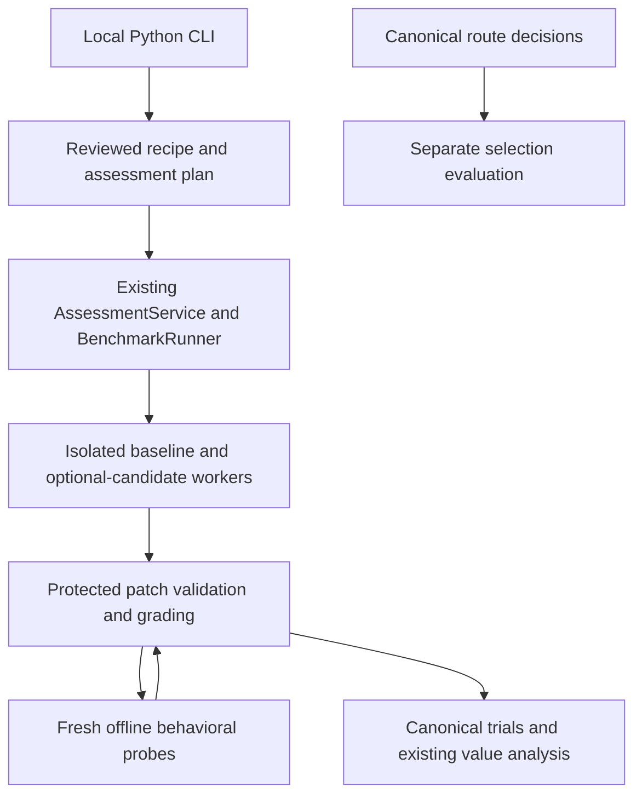

# Repository capability and selection evaluations

Use this path to test whether an optional capability helps with a bounded
repository maintenance task, then evaluate whether a selection policy makes
appropriate choices. A repaired task, a useful capability and a good selection
policy are separate results. Infrastructure measurements have their own record.

This increment adds a patch grader to the existing `AssessmentService` and
`BenchmarkRunner`. It uses the recorded managed-worker fallback because the
pinned agent-skill-eval Codex harness did not meet the required launch, usage and
isolation checks. The scripted upstream path remains available. No new evaluator,
router, database, dependency or hosted service is introduced.



## Prepare a bounded repository task

`RepositoryCase` binds a public snapshot and task to protected behavioral checks,
a reference patch, validly scoped faulty patches and source provenance. Record the exact repository revision,
source-file SHA-256, license, adaptations, independent case identity and template
family. Rights and independence require review; different hashes alone prove
neither. The supplied examples are Apache-2.0 AEEP source adaptations:

| Development task | What the grader checks | Evidence limit |
| --- | --- | --- |
| CLI option placement | Preserve existing policy arguments and insert telemetry overrides before the subcommand | Extracted reproduction of a known real regression; no model or CLI service launch |
| Token contract propagation | Preserve unknown, zero and token-category semantics across two files | Actual accounting function with a seeded faulty caller; not a historical bug claim |
| Callback binding audit | Bind both input and expected result; accept no change when correct | Known working contract and negative control |

These are small source snapshots, not full repository builds. They establish
grader behavior on fixed examples. They cannot establish general patch
correctness, independent holdout coverage or capability benefit.

From the repository root, export the inert development recipe:

```bash
PYTHONPATH=src python3 -m aeep_toolkit.cli repository-recipe \
  --cases examples/repository_evaluation/development-cases.json \
  > /tmp/aeep-repository-development-recipe.json
```

The command reads metadata and prints a definition. It starts no worker and
executes no candidate code. The development generator deliberately refuses to
materialize a campaign. A real assessment export adds `--assessment` and requires
separate curated sets of 8 qualification, 28 training and 105 holdout cases,
balanced holdout families and distinct origins/snapshots. Cases marked as used
for development cannot become holdouts. Keep related cases in the same template
family for uncertainty calculations. Do not pad a dataset with renamed examples.
Dataset-specific recipe IDs preserve earlier immutable definitions when a case
pack changes.

## Grade behavior outside the task worker

The agent receives only `RepositoryInput`: task, family, files and editable paths.
Its `RepositoryPatch` returns `base_sha256` plus replacement text for existing
editable files. The base is the canonical `content_digest` of the complete input.
The grader rejects changed base bindings, extra output fields, path escapes,
non-editable changes, binary content and oversized snapshots before dispatch.
Files omitted from the patch are preserved. Adding or deleting files is outside
this first contract. The existing structural extractor also limits the complete
public input JSON to 100,000 characters; larger snapshots are unsupported.

Recipe extension v4 uses the existing protected callback and offline
`ContainerExecutor`. For each behavioral check, a fresh container receives the
patched files and one frozen probe. The coordinator retains expected answers,
the reference patch and later checks. The child observes a frozen Python
callable's JSON result; it cannot supply an authoritative correctness verdict.
The coordinator compares results with JSON types preserved. A candidate exception
fails the behavior check. A failed transport, malformed protocol or unknown
execution outcome blocks assessment and retains accounting; it is not silently
scored as a candidate error or retried.

Candidate code is never imported into the coordinator. The selected offline
image, runtime source, recipe, probes and containment must be reviewed before
execution. The development host tests run only fixed first-party fixture bytes;
their substituted probe helper is not production containment evidence. Grader
containers expose the common AEEP runtime source, so avoid treating historical
AEEP functions already present there as secret independent holdouts. Each probe
tests bounded observable behavior; it does not prove arbitrary repository
preservation or resistance to every form of benchmark gaming.

The existing independent-grader validation runs reference outputs, literal
repairs and validly scoped semantic faults before candidate trials. Rejecting bad
metadata alone cannot validate a behavioral grader. Existing v1–v3 recipe
meanings are preserved. Budget previews conservatively reserve up to 32 contained
probe calls per graded output, including grader validation. Actual operations
and grader time remain separate from task time and task savings.

## Compare capability usefulness

Store/review the exported recipe through the existing assessment interfaces,
prepare its reviewed materialization request, then use the existing managed
assessment plan/run/report path. A definition alone grants no execution authority.
The reviewed host mapping must explain the replacement-file output schema and
canonical input hash to both arms; the development recipe alone is not a host
mapping or model-conformance result.
Keep the same capable baseline, model, reasoning effort, supporting tools and
task inputs. Treatment adds optional candidate access; required invocation belongs
only in qualification. Preserve the existing stronger-baseline, case-count,
utility, multiple-comparison and admission requirements.

Use independently graded task success as the primary usefulness question.
Predeclare wall time and any other measured resource guardrails before holdout;
unknown tokens or cash stay unknown. Inspect family-specific results, including
easy and adjacent tasks, before proposing scope. Canonical `fit_report` analysis
and the existing managed report own scientific conclusions. The new grader does
not manufacture a positive comparison or authorize admission.

## Evaluate selection independently

`SelectionEvaluation` describes a complete case-by-policy matrix. Every policy
must bind the same inventory, environment, model settings and authority. Freeze
policy definitions and task eligibility before execution. Applicable usefulness
labels need prior independent evidence; never derive them from the test task's
own outcome. Use credible static/discovery policies alongside AEEP. A synthetic
ideal policy may test the scorer, but cannot stand in for AEEP decisions.

`from_route_decision` converts an actual canonical `RouteDecision` to a bounded
selection record, verifies its task input digest and retains the decision
reference and measured routing time. Choosing the ordinary baseline records
abstention from adding a capability. Task invocation and protected grading follow
through the existing execution path. Attach those separate verification
references; a decision record alone is not a completed task.

```bash
PYTHONPATH=src python3 -m aeep_toolkit.cli selection-report \
  --evaluation /path/to/frozen-selection-evaluation.json
```

The read-only report counts useful selections, ineligible selections,
unnecessary selections, correct abstentions, missed applicable value and unknown
value separately. An always-abstain policy misses cases with established useful
capabilities. It also reports independent task grades, family counts and paired
decision overhead with measurement coverage. Missing grades and time are not
zero. The importer checks structure and bindings, but does not authenticate
supplied references or attest the workers. Its verdict stays `NOT_ASSESSED`; it
changes no admission. Live selection-value conclusions still require canonical,
source-bound execution evidence and the existing scientific analysis.

## Observe infrastructure separately

Measure setup, grading, decision overhead and whole-system resource use during
the relevant authorized workloads. Derive operational targets from task sizes,
frequency, concurrency and operator tolerance. Proposed absolute budgets are
workload hypotheses until supported and accepted; they do not replace comparative
usefulness. Existing safety guards, finite grants and the 50 GiB host reserve
remain binding.
