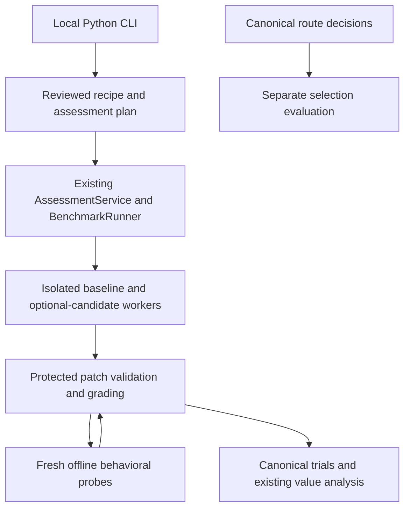

# Repository capability and selection evaluations

Use this path to test whether an optional capability helps with a bounded
repository maintenance task, then evaluate whether a selection policy makes
appropriate choices. A repaired task, a useful capability and a good selection
policy are separate results. Infrastructure measurements have their own record.

This increment adds a patch grader to the existing `AssessmentService` and
`BenchmarkRunner`. It uses the recorded managed-worker fallback because the
pinned agent-skill-eval Codex harness did not meet the required launch, usage and
isolation checks. The scripted upstream path remains available. No new evaluator,
router, database, dependency or hosted service is introduced.



## Prepare a bounded repository task

`RepositoryCase` binds a public snapshot and task to protected behavioral checks,
a reference patch, validly scoped faulty patches and source provenance. Record the exact repository revision,
source-file SHA-256, license, adaptations, independent case identity and template
family. Rights and independence require review; different hashes alone prove
neither. The supplied examples are Apache-2.0 AEEP source adaptations:

| Development task | What the grader checks | Evidence limit |
| --- | --- | --- |
| CLI option placement | Preserve existing policy arguments and insert telemetry overrides before the subcommand | Extracted reproduction of a known real regression; no model or CLI service launch |
| Token contract propagation | Preserve unknown, zero and token-category semantics across two files | Actual accounting function with a seeded faulty caller; not a historical bug claim |
| Callback binding audit | Bind both input and expected result; accept no change when correct | Known working contract and negative control |

These are small source snapshots, not full repository builds. They establish
grader behavior on fixed examples. They cannot establish general patch
correctness, independent holdout coverage or capability benefit.

From the repository root, export the inert development recipe:

```bash
PYTHONPATH=src python3 -m aeep_toolkit.cli repository-recipe \
  --cases examples/repository_evaluation/development-cases.json \
  > /tmp/aeep-repository-development-recipe.json
```

The command reads metadata and prints a definition. It starts no worker and
executes no candidate code. The development generator deliberately refuses to
materialize a campaign. A real assessment export adds `--assessment` and requires
separate curated sets of 8 qualification, 28 training and 105 holdout cases,
balanced holdout families and distinct origins/snapshots. Cases marked as used
for development cannot become holdouts. Keep related cases in the same template
family for uncertainty calculations. Do not pad a dataset with renamed examples.
Dataset-specific recipe IDs preserve earlier immutable definitions when a case
pack changes.

## Grade behavior outside the task worker

The agent receives only `RepositoryInput`: task, family, files and editable paths.
Its `RepositoryPatch` returns `base_sha256` plus replacement text for existing
editable files. The base is the canonical `content_digest` of the complete input.
The grader rejects changed base bindings, extra output fields, path escapes,
non-editable changes, binary content and oversized snapshots before dispatch.
Files omitted from the patch are preserved. Adding or deleting files is outside
this first contract. The existing structural extractor also limits the complete
public input JSON to 100,000 characters; larger snapshots are unsupported.

Recipe extension v4 uses the existing protected callback and offline
`ContainerExecutor`. For each behavioral check, a fresh container receives the
patched files and one frozen probe. The coordinator retains expected answers,
the reference patch and later checks. The child observes a frozen Python
callable's JSON result; it cannot supply an authoritative correctness verdict.
The coordinator compares results with JSON types preserved. A candidate exception
fails the behavior check. A failed transport, malformed protocol or unknown
execution outcome blocks assessment and retains accounting; it is not silently
scored as a candidate error or retried.

Candidate code is never imported into the coordinator. The selected offline
image, runtime source, recipe, probes and containment must be reviewed before
execution. The development host tests run only fixed first-party fixture bytes;
their substituted probe helper is not production containment evidence. Grader
containers expose the common AEEP runtime source, so avoid treating historical
AEEP functions already present there as secret independent holdouts. Each probe
tests bounded observable behavior; it does not prove arbitrary repository
preservation or resistance to every form of benchmark gaming.

The existing independent-grader validation runs reference outputs, literal
repairs and validly scoped semantic faults before candidate trials. Rejecting bad
metadata alone cannot validate a behavioral grader. Existing v1–v3 recipe
meanings are preserved. Budget previews conservatively reserve up to 32 contained
probe calls per graded output, including grader validation. Actual operations
and grader time remain separate from task time and task savings.

## Prepare real repository test suites

Extension v5 adds a separate source-archive path for real Python repository
tasks. It reuses the existing worker artifact transport and a pinned SWE-rebench
pytest parser. The initial upstream Loguru compatibility check passed its
unchanged, published-repair and regression variants on source 5f4e318c. That
result applies to one development task; the new v5 integration still requires
source checks and fresh contained conformance before model trials.

`RepositorySuiteCase` binds a small public task record to hash-checked assets:
the original source archive, private test overlay, published patch artifact and
exact runtime wheels. Record license/provenance and `origin_kind` as
`upstream_issue`, `authored_control` or `synthetic_fixture`. The default is
synthetic. A declared real origin is not an attestation. Keep reviewed public
archives under one dedicated root, named `<sha256>.tar.gz`; keep tests, references
and runtime wheels in a different protected directory.

Export the inert definition from a configured source environment:

```bash
PYTHONPATH=src python3 -m aeep_toolkit.cli repository-suite-recipe \
  --cases /path/to/development-cases.json \
  > /tmp/aeep-repository-suite-recipe.json
```

Each cases file contains an array matching
[the suite schema](../../schemas/assessment-repository-suite-case.schema.json).
Repeat `--cases` for separate metadata files; the existing 1 MiB read limit
applies to each file. Export reads reviewed assets but starts no worker or
installer. It requires three development cases. `--assessment` additionally
requires source-disjoint 8/28/105 cases; materialization enforces balanced
holdout families. Development exports cannot generate campaign holdouts.

The declarative host adapter uses `input_transform: repository_archive:1` and
one `read_only_roots` entry naming the public asset directory. It loads only the
current hash-named archive and adds `source_b64` and the canonical `base_sha256`.
Use the existing artifact configuration with `input_field: source_b64`,
`output_field: patch_b64`, `input_name: repository.tar.gz`,
`output_name: patch.json` and `max_bytes: 650000`. The host sends the archive as
a file, removes its base64 bytes from the prompt and provides input/output paths.
Both arms receive the same instructions and artifact delivery.

The agent unpacks the source into its private workspace and writes `patch.json`
with the supplied base hash and replacement text for existing editable Python
files. The artifact bridge returns that file as `patch_b64`. The coordinator
rejects changed bindings, duplicate JSON keys, source escapes, new/deleted files,
test/configuration edits and oversized patches before execution. It overlays
the private tests and runs the reviewed pytest command in one fresh offline
grader. The child returns test observations, not an authoritative verdict.

Curated materialization copies reviewed metadata on one canonical operation.
Published reference patches are data, not an independently executed generator;
each is validated with the contained tests before candidate execution. V5 retains
the legacy generator/reference executor slots but does not dispatch them. Budget
previews count one possible grader call per output and no external reference
calls. Grading remains assessment overhead, outside paired task wall time.

The current byte/member limits protect the existing 2 MB container envelope and
32 MiB temporary filesystem. They are transport/safety bounds, not accepted
production latency or memory targets. Each archive is at most 650,000 compressed
bytes, expands to at most 4,000,000 file bytes and has at most 1,000 regular files.
The complete current-case payload must also fit the existing envelope; a large
runtime closure can make a smaller archive unsupported. No installer or build
backend runs in the grader. Tasks needing compiled dependencies, larger trees,
different Python runtimes or a changed timeout remain unsupported until separately
reviewed. Official upstream image equivalence is not claimed.

Missing, skipped, errored or nonpassing required tests fail validation. A malformed
transport or changed asset blocks assessment. Standard upstream log parsing and
test suites do not prove resistance to adversarial output forgery or incomplete
tests. Curate reproducible workloads and retain these limits in the report.
The existing comparison and selection analysis below remain unchanged.

### Tests that need a pytest plugin

Use `assessment.repository-suite-case.v2` for a suite that needs a specific pytest
plugin. Its protected truth adds a nonempty `pytest_plugins` list, such as
`["pytest_mock"]`. Module names must be distinct, bounded dotted identifiers;
paths, flags and entry-point expressions are rejected. Version-1 cases reject
the field. Their serialized definitions and legacy-only observer stay unchanged.

The v2 observer keeps automatic plugin loading disabled. It imports pytest and
declared plugins from the reviewed runtime before adding candidate source paths.
It then checks that no editable project module was already loaded. A conflict
blocks grading; it cannot count an installed library as the candidate's patch.
The public task and model-supplied patch cannot enable plugins. A plugin-enabled
recipe has a separate observer fingerprint and identity, and needs fresh review
and applicable conformance. Mixed recipes use that reviewed observer for every
case. Older conformance is not transferred to it.

The declaration neither installs nor downloads a package. Keep plugin wheels
within the existing bounds or provision a separately reviewed pinned grader
image. Review the full dependency closure, license terms and runtime applicability.
Required test identities stay fixed: missing plugin-generated tests cannot be
removed merely to make a reference pass. First-party process fixtures verify the
import order and conflict stop; external plugin execution remains unqualified
until a separately authorized contained check completes.

Published Python file counts are curation hints. Inspect source-body changes and
test obligations before calling a task a multi-file repair; documentation-string
edits in extra Python files do not supply that evidence.

## Compare capability usefulness

Store/review the exported recipe through the existing assessment interfaces,
prepare its reviewed materialization request, then use the existing managed
assessment plan/run/report path. A definition alone grants no execution authority.
The reviewed host mapping must explain the replacement-file output schema and
canonical input hash to both arms; the development recipe alone is not a host
mapping or model-conformance result.
Keep the same capable baseline, model, reasoning effort, supporting tools and
task inputs. Treatment adds optional candidate access; required invocation belongs
only in qualification. Preserve the existing stronger-baseline, case-count,
utility, multiple-comparison and admission requirements.

Use independently graded task success as the primary usefulness question.
Predeclare wall time and any other measured resource guardrails before holdout;
unknown tokens or cash stay unknown. Inspect family-specific results, including
easy and adjacent tasks, before proposing scope. Canonical `fit_report` analysis
and the existing managed report own scientific conclusions. The new grader does
not manufacture a positive comparison or authorize admission.

## Evaluate selection independently

`SelectionEvaluation` describes a complete case-by-policy matrix. Every policy
must bind the same inventory, environment, model settings and authority. Freeze
policy definitions and task eligibility before execution. Applicable usefulness
labels need prior independent evidence; never derive them from the test task's
own outcome. Use credible static/discovery policies alongside AEEP. A synthetic
ideal policy may test the scorer, but cannot stand in for AEEP decisions.

`from_route_decision` converts an actual canonical `RouteDecision` to a bounded
selection record, verifies its task input digest and retains the decision
reference and measured routing time. Choosing the ordinary baseline records
abstention from adding a capability. Task invocation and protected grading follow
through the existing execution path. Attach those separate verification
references; a decision record alone is not a completed task.

```bash
PYTHONPATH=src python3 -m aeep_toolkit.cli selection-report \
  --evaluation /path/to/frozen-selection-evaluation.json
```

The read-only report counts useful selections, ineligible selections,
unnecessary selections, correct abstentions, missed applicable value and unknown
value separately. An always-abstain policy misses cases with established useful
capabilities. It also reports independent task grades, family counts and paired
decision overhead with measurement coverage. Missing grades and time are not
zero. The importer checks structure and bindings, but does not authenticate
supplied references or attest the workers. Its verdict stays `NOT_ASSESSED`; it
changes no admission. Live selection-value conclusions still require canonical,
source-bound execution evidence and the existing scientific analysis.

## Observe infrastructure separately

Measure setup, grading, decision overhead and whole-system resource use during
the relevant authorized workloads. Derive operational targets from task sizes,
frequency, concurrency and operator tolerance. Proposed absolute budgets are
workload hypotheses until supported and accepted; they do not replace comparative
usefulness. Existing safety guards, finite grants and the 50 GiB host reserve
remain binding.

## Larger replacement-file artifacts

Use `assessment.repository-suite-case.v3` when a small repair touches enough
source text to exceed the legacy 500000-byte patch JSON limit. Its protected truth
requires `patch_encoding: gzip-json`. Write the same base hash and replacement
file mapping as gzip-compressed UTF-8 JSON. Configure the existing artifact bridge
with `output_name: patch.json.gz` and `output_field: patch_gzip_b64`; keep the
current public-archive input mapping. `compressed_patch_artifact` provides the
operator-side encoding helper. Both agent arms need identical output instructions.
A campaign can convert its new cases to v3 before freezing the common mapping;
old cases and evidence retain their original definitions.

The compressed patch may contain at most 500000 bytes; expanded JSON and its file
mapping may contain at most 4000000 bytes. The source tree, protected overlay and
complete grader payload must still fit their existing bounds. Invalid compression,
changed base hashes, duplicate keys, unsafe paths and test/configuration edits
fail before dispatch. The optional `pytest_plugins` list follows the existing v2
review and import-order rules; an empty list is allowed. V3 reuses that observer.

This uses standard-library gzip, already used for source archives. It avoids a new
parser or host executable. It remains whole-file replacement, with no unified-diff
syntax or claim of token/time/cash savings. V1/v2 encodings, schemas, recipe digests
and limits remain unchanged. New definitions still need applicable source-bound
runtime checks and execution authority; fixtures cannot qualify the new transport.
